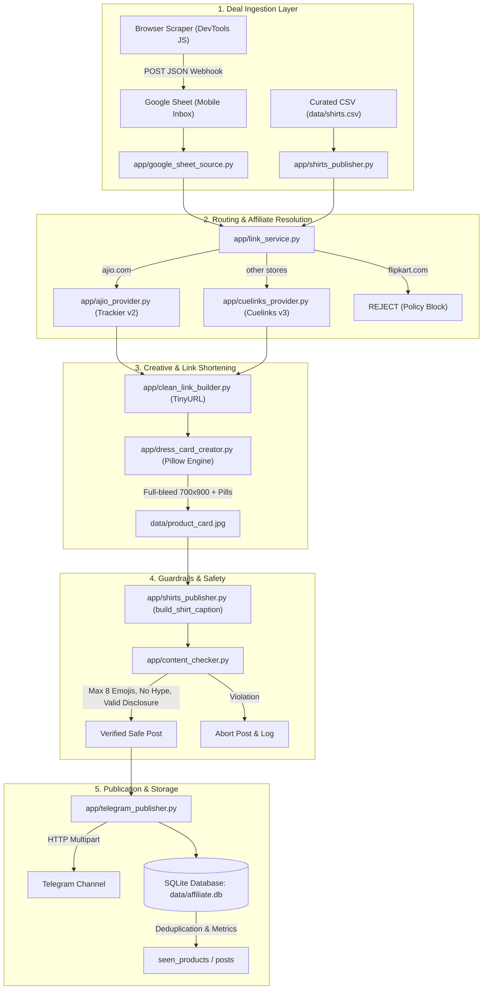

# 🚀 AI-Powered Affiliate Automation Bot (AJIO & E-Commerce Deals)

> **Production-Ready Open-Source Showcase & Architecture Handover**  
> An automated, compliance-first deal discovery, link monetization, dynamic creative generation, and Telegram publishing engine built in Python.

[](tests/)
[](https://www.python.org/)
[](LICENSE)
[](#-compliance--hard-rules)

---

## 📌 Executive Summary

This repository is designed to autonomously discover high-discount fashion deals (e.g. **Men's Full-Sleeve Shirts Under ₹500**), convert raw store links into commission-eligible affiliate links with 100% parameter preservation, shorten them into clean 1-line URLs, generate sleek full-bleed image cards, and publish them on schedule to Telegram with zero human intervention.

For other AI agents reviewing this repository, read the in-depth specification in [docs/PROJECT_POC_HANDOVER.md](docs/PROJECT_POC_HANDOVER.md).

---

## 🏗️ Architecture & Data Flow



---

## 🛡️ Compliance & Hard Rules

1. **🚫 Flipkart is Permanently Blocked:** Hard-coded in `app/eligibility_validator.py` and `app/link_service.py`. No Flipkart affiliate links can ever be generated.
2. **⚖️ Mandatory Affiliate Disclosure:** Every single post ends with:  
   `Affiliate link - I may earn a commission at no extra cost to you.`
3. **🔍 Zero Fabricated Data:** Prices, discounts, and ratings are strictly extracted from verified API/Sheet fields. If unverified, the bot displays `"Check the latest price on store"`.
4. **🛑 Deterministic Guardrails (`content_checker.py`):**
   - Maximum 8 emojis per post.
   - Banned hype words (`loot`, `steal`, `hack`, `guarantee`, `lowest price`, `hurry`).

---

## 📂 Codebase Overview

```text
├── app/
│   ├── config.py                 # Pydantic Settings & environment variables
│   ├── models.py                 # Dataclasses: Product, AffiliateLink
│   ├── link_service.py           # Universal router (AJIO ACE vs Cuelinks)
│   ├── ajio_provider.py          # AJIO ACE Trackier v2 link builder
│   ├── clean_link_builder.py     # TinyURL shortener (retains 100% affiliate params)
│   ├── dress_card_creator.py     # Pillow-based full-bleed card generator
│   ├── content_checker.py        # Deterministic guardrails (hype words, emojis)
│   ├── shirts_publisher.py       # Caption formatter, rating display, hashtag builder
│   ├── telegram_publisher.py     # Telegram Bot API client (dry-run safe)
│   ├── google_sheet_source.py    # Google Sheet / Apps Script connector
│   ├── db.py                     # SQLite schema (products, posts, seen_products)
│   └── run_daily.py              # Collision-locked runner for GitHub Actions / cron
├── apps_script/
│   ├── BEST_SHIRTS_UNDER_500_SCRAPER.js  # Browser console scraper (rating >= 3.8*)
│   └── ajio_auto_scraper.gs      # Google Apps Script Webhook receiver
├── docs/
│   └── PROJECT_POC_HANDOVER.md   # Comprehensive technical architectural spec
├── tests/                        # 55 offline unit tests
├── .github/workflows/
│   └── daily_bot.yml             # GitHub Actions CI/CD daily scheduler
└── requirements.txt              # Core dependencies
```

---

## 🛠️ Quick Start & Setup

### 1. Clone & Setup Environment
```bash
git clone https://github.com/DineshRocky07/affiliate-deals-automation.git
cd affiliate-deals-automation
python -m venv .venv
source .venv/bin/activate  # On Windows: .venv\Scripts\activate
pip install -r requirements.txt
cp .env.example .env
```

### 2. Run the Offline Unit Tests
All 55 tests run completely offline without needing live API keys:
```bash
python -m unittest discover -s tests -v
```

### 3. Run in Dry-Run Preview Mode
Test caption generation, image card rendering, and deduplication locally without posting to Telegram:
```bash
python -m app.run_daily
```

---

## 🤖 Guide for Reviewing AI Agents

When evaluating or extending this repository:
1. **Architecture First:** Inspect `docs/PROJECT_POC_HANDOVER.md` for complete data structures.
2. **Offline-First Testing:** Run `python -m unittest discover -s tests -v` before and after every modification.
3. **Preserve Tracking Parameters:** When modifying `clean_link_builder.py` or `ajio_provider.py`, verify that `clickid`, `pub_id`, and `utm_source` remain intact through redirects.
4. **Card Visuals:** Creative cards are rendered in `app/dress_card_creator.py` at $700 \times 900$ pixels with floating rounded badges.

---

## 📄 License
MIT License. Created for education, ethical automation, and affiliate marketing engineering.
