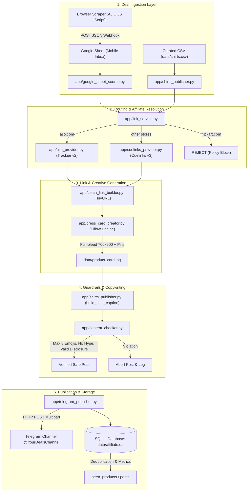

# Affiliate Deals Automation Bot — Full POC & Architecture Handover

> **Target Audience:** Autonomous AI Agents (Gemini, Claude Code, Cursor, Antigravity) and Senior Software Engineers.  
> **Repository:** `https://github.com/DineshRocky07/affiliate-deals-automation.git`  
> **Target Channel:** Telegram Channel `@YourDealsChannel`  
> **Operating Environment:** Python 3.12+ (Windows / Linux GitHub Actions CI/CD)

---

## 1. Executive Summary & Mission

This project is an automated, production-grade affiliate deal discovery, monetization, card creation, and publishing engine. It ingests high-discount e-commerce products (focused on high-converting fashion categories such as Men's Shirts Under ₹500), transforms raw product links into commission-eligible tracking links, shortens them into clean URLs, renders dynamic full-bleed image cards, applies deterministic compliance guardrails, and publishes them daily to Telegram.

### Core Business & Technical Goals
* **Automated Revenue:** Generate recurring commission (Target: $\ge$ ₹2,000/month) via authorized affiliate networks.
* **100% Attribution Integrity:** Links must never drop affiliate tags (`clickid`, `pub_id`, `subid`).
* **Strict Anti-Ban & Compliance:** Hard stop against banned affiliate platforms (e.g. Flipkart is strictly disabled), zero fabricated data (prices/ratings), and strict limits on hype terminology.
* **Autonomous DevOps:** Runs automatically every 4 hours via GitHub Actions with collision-safe lockfiles.

---

## 2. System Architecture & Data Flow



---

## 3. Core Hard Rules (Never Violate)

1. **Flipkart is PERMANENTLY DISABLED:** Never generate Flipkart affiliate links. Enforced at both provider and service levels (`BLOCKED_DOMAINS` and `BLOCKED_CAMPAIGNS`).
2. **Zero Data Fabrication:** Prices, MRPs, discounts, and ratings must come directly from verified API responses. If price is unverified, `price_verified=False` and the bot must output *"Check the latest price on store"*.
3. **Mandatory Affiliate Disclosure:** Every post must conclude with:
   `<i>Affiliate link - I may earn a commission at no extra cost to you.</i>`
4. **Deterministic Guardrails:** `content_checker.py` rejects any caption containing:
   - $> 8$ emojis.
   - Banned hype words (`loot`, `steal`, `hack`, `guarantee`, `lowest price`, `hurry`, `don't miss`).
5. **Idempotent Publishing:** Products must be deduplicated across runs using SQLite (`seen_products` table) so customers never receive duplicate spam.

---

## 4. Affiliate Routing & Attribution Engine

### A. AJIO ACE Program (Trackier v2 Integration)
AJIO links do not use standard web scrapers due to Akamai bot protection. Instead, links are monetized directly via Trackier v2 tracking redirect endpoints:

* **Base Endpoint:** `https://ajiotrk.vibconnect.in/click`
* **Publisher ID (`pub_id`):** `16469`
* **Campaign ID (`campaign_id`):** `1`
* **Parameters Passed:**
  - `p1`: SubID/Channel tag (e.g. `deals_shirts`)
  - `p2`: Telegram channel handle (`viodFallDeals`)
  - `url`: URL-encoded direct AJIO product link

#### The Full Redirect Chain:
$$\text{TinyURL} \xrightarrow{301} \text{Trackier Endpoint} \xrightarrow{302} \text{ajio.com/product?clickid=...&utm_source=Dinesh}$$

### B. Clean Shortening Engine (`app/clean_link_builder.py`)
Because raw affiliate URLs span 5+ lines and can trigger antivirus or browser warning screens, `shorten_any_affiliate_link()` converts the long URL into an authentic, instant `tinyurl.com` link via `https://tinyurl.com/api-create.php?url=...`.
* **Idempotency Guard:** If the link is already shortened to `tinyurl.com`, it skips redundant calls.
* **Parameter Preservation:** 100% of tracking parameters (`clickid`, `pub_id`, `subid`) remain intact through HTTP 301/302 redirects.

---

## 5. Visual Creative Engine (`app/dress_card_creator.py`)

Rather than posting plain text or raw square product pictures, the bot generates custom high-converting visual cards using Pillow (PIL):

* **Dimensions:** 700px width $\times$ 900px height.
* **Layout:** Full-bleed image scaling (`fit_image` preserving aspect ratio with clean center cropping).
* **Floating UI Badges:**
  1. **Top-Left Discount Pill:** Solid `#dc2626` (Red) rounded rectangle with `{discount}% OFF`.
  2. **Top-Left Brand Pill:** Dark Navy `#0f172a` pill with Sky Blue `#38bdf8` text displaying verified brand (e.g. `DNMX`, `LEVI'S`, `ALPHA TRIBE`).
  3. **Bottom-Right Price Pill:** Dark Navy `#0f172a` pill with Emerald Green `#22c55e` deal price and strike-through red line over original MRP.

---

## 6. Project Codebase Map

| File Path | Primary Responsibility | Key Inputs / Outputs |
|---|---|---|
| `app/config.py` | Pydantic-style centralized settings | Loads `.env` and environment variables. |
| `app/models.py` | Core dataclasses: `Product`, `AffiliateLink` | Defines type contracts and `.discount_pct`. |
| `app/link_service.py` | Universal router for all product URLs | Routes to AJIO ACE or Cuelinks; blocks Flipkart. |
| `app/ajio_provider.py` | AJIO ACE Trackier URL builder | Outputs verified `AffiliateLink` object. |
| `app/clean_link_builder.py`| TinyURL shortener & Cuelinks link builder | Converts raw affiliate links to 1-line clean links. |
| `app/dress_card_creator.py`| Pillow-based full-bleed image card generator| Downloads image and saves `data/product_card.jpg`. |
| `app/content_checker.py` | Deterministic guardrails (emojis, hype words)| Validates caption safety; raises `ContentRejected`. |
| `app/shirts_publisher.py`| Caption builder & batch publisher | Builds HTML captions, generates hashtags, posts deals. |
| `app/telegram_publisher.py`| Telegram Bot API wrapper | Calls `sendPhoto` / `sendMessage`; handles dry runs. |
| `app/google_sheet_source.py`| Google Sheet / Apps Script connector | Fetches deals added via mobile or browser scraper. |
| `app/db.py` | SQLite schema, deduplication, and metrics | Tables: `products`, `posts`, `metrics`, `seen_products`. |
| `app/run_daily.py` | Main entry point for GitHub Actions & cron | Collision lock (`.daily_run.lock`), executes batch run. |
| `apps_script/BEST_SHIRTS_UNDER_500_SCRAPER.js` | Browser-based AJIO scraper for men's shirts | Runs in DevTools; filters $\ge 3.8\star$, full sleeves only. |
| `.github/workflows/daily_bot.yml` | GitHub Actions automated runner | Cron schedule `0 */4 * * *` + workflow dispatch. |

---

## 7. Concrete Code Examples

### Example 1: Resolving and Shortening an AJIO Affiliate Link
```python
from app.config import get_settings
from app.link_service import resolve_affiliate_link
from app.clean_link_builder import shorten_any_affiliate_link

settings = get_settings()
raw_product_url = "https://www.ajio.com/alpha-tribe-men-regular-fit-shirt-with-full-sleeves/p/704041690_navy"

# 1. Resolve via AJIO ACE Trackier
affiliate_link = resolve_affiliate_link(
    product_id="AJIO-704041690_navy",
    product_url=raw_product_url,
    settings=settings,
    subid="deals_shirts"
)

# 2. Shorten for clean presentation
clean_url = shorten_any_affiliate_link(affiliate_link.tracking_url)
print("Shortened URL:", clean_url)
# Output: https://tinyurl.com/274bhvh4
```

### Example 2: Caption Formatting with Guardrails
```python
from app.models import Product
from app.shirts_publisher import build_shirt_caption
from app.content_checker import enforce_caption_safety

product = Product(
    product_id="AJIO-704041690_navy",
    title="Alpha Tribe Men Regular Fit Shirt with Full Sleeves",
    url="https://www.ajio.com/alpha-tribe-men-regular-fit-shirt-with-full-sleeves/p/704041690_navy",
    price=330.0,
    mrp=3000.0,
    price_verified=True,
    rating=4.1,
    rating_count=124
)

caption = build_shirt_caption(product, tracking_url="https://tinyurl.com/274bhvh4")

# Validate against deterministic rules (raises ContentRejected if invalid)
enforce_caption_safety(headline="", caption=caption, product=product)
```

---

## 8. Environment Variables Reference (`.env`)

```ini
# --- Safety Switches ---
DRY_RUN=false                      # Set to 'false' for live posting to Telegram
USE_AI=true                        # Enables AI review/copy when available

# --- AJIO ACE Program (Trackier v2) ---
AJIO_API_KEY=YOUR_AJIO_API_KEY
AJIO_CAMPAIGN_ID=1
AJIO_PUB_ID=16469
AJIO_TRACKING_BASE=https://ajiotrk.vibconnect.in/click
SHORTEN_AFFILIATE_LINKS=true       # Automatically generate TinyURLs

# --- Telegram Bot Configuration ---
TELEGRAM_BOT_TOKEN=1234567890:ABCdefGHIjklMNOpqrsTUVwxyz
TELEGRAM_CHAT_ID=@YourDealsChannel

# --- Google Sheet & Inbox ---
GOOGLE_SHEET_ID=YOUR_GOOGLE_SHEET_ID
GOOGLE_WORKSHEET=deals
GOOGLE_CREDENTIALS_FILE=credentials/google-service-account.json
SHEET_CLEAR_AFTER_POST=false
ALLOW_CSV_INVENTORY=false

# --- Cuelinks Configuration (v3 API) ---
CUELINKS_API_KEY=YOUR_CUELINKS_API_KEY
CUELINKS_API_URL=https://developers.cuelinks.com/pub_api/v3
CUELINKS_CID=249658
```

---

## 9. Verification & Testing Procedures

Before making any changes or pushing to git, the successor agent must execute the offline unit test suite:

```bash
# Must pass 55/55 tests in under 1 second without internet connection
python -m unittest discover -s tests -v
```

### Key Tests Included:
* `test_ajio_link_generation`: Asserts correct Trackier query params (`pub_id`, `campaign_id`, `url`).
* `test_flipkart_blocked`: Asserts Flipkart links raise rejection.
* `test_guardrails_detect_hype`: Asserts words like `loot` and `steal` are rejected.
* `test_safe_caption_contains_disclosure`: Asserts mandatory disclosure presence.
* `test_dry_run_never_calls_telegram`: Verifies mock safety in dry-run mode.

---

## 10. Recommended Roadmap for Successor Agents

1. **Phase 1: Automated Video/Reels Generator**
   - Synthesize product image + animated price zoom + background music into 15-second vertical MP4s using `moviepy` or `ffmpeg`.
2. **Phase 2: Multi-Platform Expansion (Amazon India)**
   - Integrate Amazon PA-API 5.0 for verified price lookups and auto-disclosure compliance.
3. **Phase 3: Instagram Graph API Auto-Poster**
   - Connect Telegram queue to Instagram Reels / Carousel posts via official Meta Business API.
4. **Phase 4: Real-Time Click & Commission Analytics**
   - Query Trackier / Cuelinks reporting APIs daily to store confirmed earnings in the `metrics` SQLite table.
